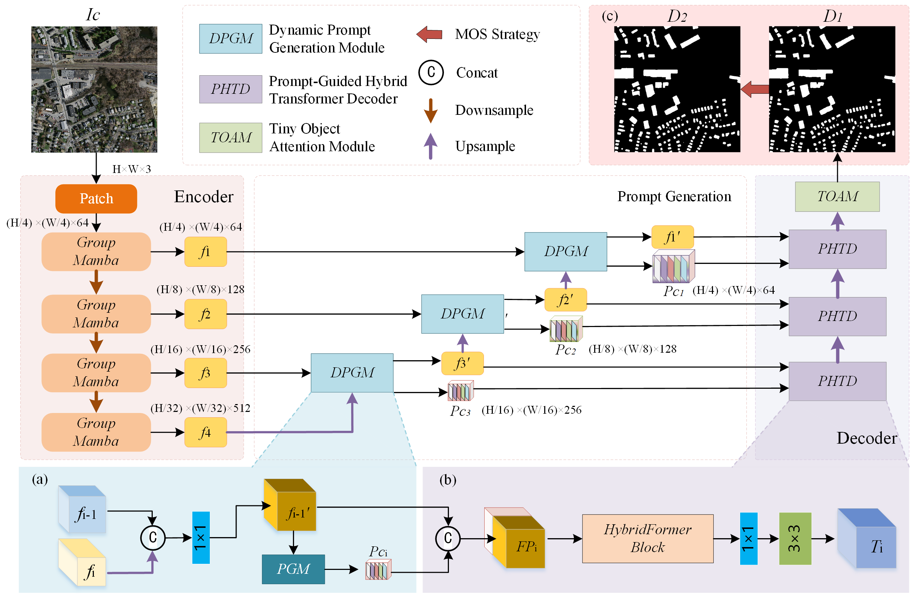
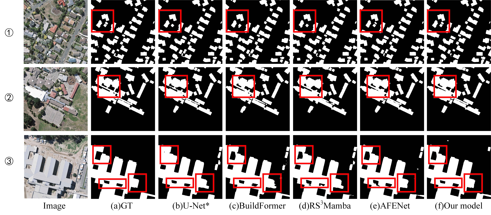

# PGD-Net: Prompt-Guided Hybrid Transformer Decoder for Building Extraction from Remote Sensing Images

[](https://doi.org/10.1080/15481603.2026.2741472)

Official implementation of **PGD-Net**, a prompt-guided hybrid Transformer framework for building extraction from very-high-resolution remote sensing imagery.

> **Published in GIScience & Remote Sensing, 2026**  
> [PGD-Net: Prompt-Guided Hybrid Transformer Decoder for building extraction from remote sensing images](https://doi.org/10.1080/15481603.2026.2741472)

## Overview

Accurate building extraction from remote sensing imagery is essential for urban planning, cadastral mapping, and geographic information updating. However, existing methods still struggle with semantic degradation during feature decoding, small-building detection, and accurate boundary delineation. To address these issues, we propose PGD-Net, which integrates feature-conditioned prompt guidance into the decoding process for building extraction. The proposed method introduces learnable internal feature prompts to compensate for degraded building semantics. These prompts are further integrated into a hybrid Transformer decoding framework to guide feature reconstruction. Furthermore, a two-level optimization strategy is adopted: TOAM enhances small-building feature responses at the feature level, while a lightweight morphological post-processing step is applied at the output level to refine predicted masks and alleviate boundary discontinuities. Experiments were conducted on three public benchmark datasets, including Massachusetts, WHU, and Inria, as well as the newly constructed Xiamen Building Dataset (XM). PGD-Net achieved IoU scores of 76.81%, 92.05%, and 84.18% on the Massachusetts, WHU, and Inria datasets, respectively. It also delivered the best performance on the XM dataset, which contains a large number of dense urban-village buildings with severe occlusions and shadows. The results demonstrate that PGD-Net effectively improves extraction completeness, boundary accuracy, and small-building detection performance in complex urban environments.



## Highlights

- Achieves IoU scores of **76.81%**, **84.18%**, and **92.05%** on the Massachusetts, Inria, and WHU building datasets, respectively.
- Demonstrates strong extraction completeness, boundary accuracy, and small-building detection across diverse urban scenes.
- Achieves the best reported performance on the newly constructed Xiamen Building (XM) dataset, which includes dense urban-village buildings affected by occlusion and shadows.

## Quantitative Results

| Dataset | Precision (%) | Recall (%) | F1 (%) | IoU (%) |
|:--|--:|--:|--:|--:|
| Massachusetts | 86.41 | 87.35 | 86.88 | **76.81** |
| Inria | 92.40 | 90.44 | 91.41 | **84.18** |
| WHU | 96.08 | 95.64 | 95.86 | **92.05** |

## Qualitative Results

The examples below compare PGD-Net with representative baselines on the WHU dataset. PGD-Net better preserves small auxiliary buildings, sharp corners, and boundaries adjoining roads or vegetation.



## Installation

Create and activate the environment:

```bash
conda create -n airs python=3.8
conda activate airs

conda install pytorch==1.10.0 torchvision==0.11.0 torchaudio==0.10.0 cudatoolkit=11.3 -c pytorch -c conda-forge
pip install -r requirements.txt
```

## Data Preparation

The preprocessing pipeline follows [BuildFormer](https://github.com/WangLibo1995/BuildFormer) for all datasets. For the Massachusetts dataset, we further follow [DSAT-Net](https://github.com/stdcoutzrh/BuildingExtraction). The `split_1500_to_512.py` script resizes images from 1500 x 1500 to 512 x 512 pixels:

```bash
python tools/split_1500_to_512.py
```

## Training

```bash
# WHU
python train_supervision.py -c ./config/whu/PGDNet.py

# Inria
python train_supervision.py -c ./config/inria/PGDNet.py

# Massachusetts
python train_supervision.py -c ./config/mass/PGDNet.py
```

## Evaluation

```bash
# WHU
python building_seg_test.py -c ./config/whu/PGDNet.py -o /path/to/whu/results --rgb -t lr

# Inria
python building_seg_test.py -c ./config/inria/PGDNet.py -o /path/to/inria/results --rgb -t lr

# Massachusetts
python building_seg_test.py -c ./config/mass/PGDNet.py -o /path/to/massachusetts/results --rgb -t lr
```

## Citation

If you find this repository useful, please cite our paper:

```bibtex
@article{wu2026pgdnet,
  title     = {PGD-Net: Prompt-Guided Hybrid Transformer Decoder for building extraction from remote sensing images},
  author    = {Wu, Shuizhen and Yu, Peng and Chen, Shengbo and Li, Mengmeng and Song, Pu and Zhong, Xiaojing and Li, Guangchun and Chen, Yiping},
  journal   = {GIScience \& Remote Sensing},
  volume    = {63},
  number    = {1},
  pages     = {2741472},
  year      = {2026},
  publisher = {Taylor \& Francis},
  doi       = {10.1080/15481603.2026.2741472},
  url       = {https://doi.org/10.1080/15481603.2026.2741472}
}
```

## Acknowledgements

This project builds upon the following open-source repositories: [BuildFormer](https://github.com/WangLibo1995/BuildFormer), [CLCFormer](https://github.com/long123524/CLCFormer), [DSAT-Net](https://github.com/stdcoutzrh/BuildingExtraction), [UNet](https://github.com/zhixuhao/unet), [GroupMamba](https://github.com/Amshaker/GroupMamba), [PyTorch Lightning](https://www.pytorchlightning.ai/), [timm](https://github.com/rwightman/pytorch-image-models), [pytorch-toolbelt](https://github.com/BloodAxe/pytorch-toolbelt), [ttach](https://github.com/qubvel/ttach), [Catalyst](https://github.com/catalyst-team/catalyst), and [MMSegmentation](https://github.com/open-mmlab/mmsegmentation).
